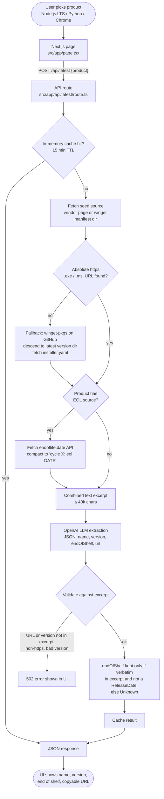

# AI Patch Crawler

PoC: pick **Node.js LTS**, **Python**, or **Chrome**, get **name**, **version**, **end-of-shelf** (or Unknown), and a **copyable Windows x64 download URL**. An LLM extracts those fields from the official vendor page, winget installer manifests, and [endoflife.date](https://endoflife.date) (hallucinations rejected).

## Workflow



| Product | Installer URL source | EOS date source |
|---------|----------------------|-----------------|
| Node.js LTS | winget `OpenJS.NodeJS.LTS` manifest | endoflife.date `nodejs` |
| Python | python.org Windows downloads page (winget fallback) | endoflife.date `python` |
| Chrome | google.com/chrome (winget `Google.Chrome` fallback) | none (Unknown) |

## Run

```bash
cp .env.example .env.local   # set OPENAI_API_KEY
npm install
npm run dev                  # http://localhost:3000
```

Without `OPENAI_API_KEY`, the UI loads but **Find latest** fails.

## Env

| Variable | Required | Notes |
|----------|----------|-------|
| `OPENAI_API_KEY` | yes | OpenAI key for extraction |
| `OPENAI_MODEL` | no | default `gpt-4o-mini` |
